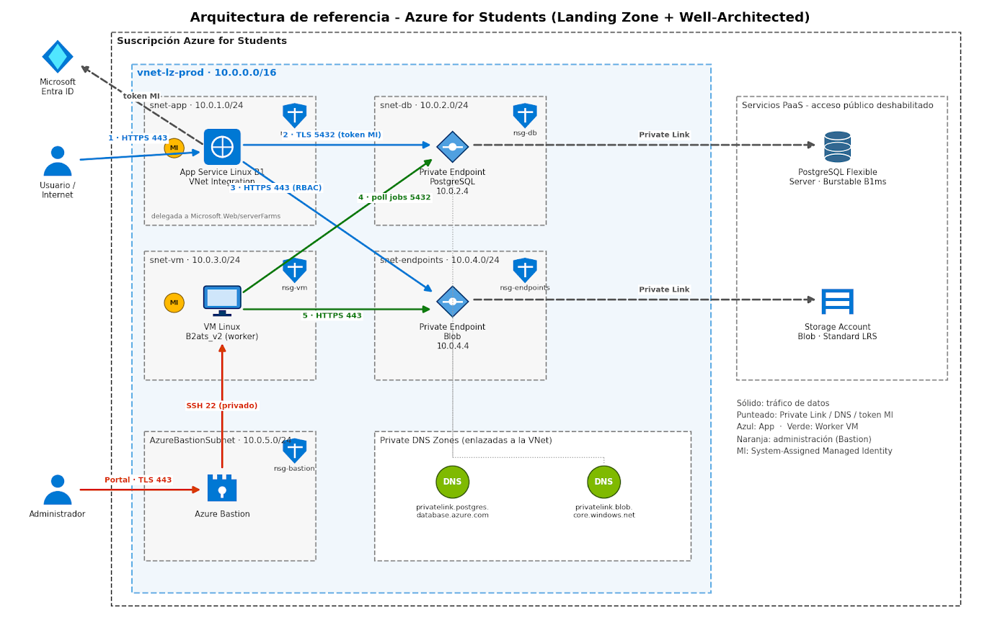

# Terraform · Arquitectura de referencia Azure for Students

Infraestructura como código (IaC) en Terraform de la arquitectura de referencia del proyecto
**integradora** de la UTVT, diseñada con los principios de Azure Landing Zone y del
Well-Architected Framework y desplegada en la suscripción *Azure for Students*
(región **México Central**).



## Componentes

| Capa      | Recurso                                   | Configuración |
|-----------|-------------------------------------------|---------------|
| Red       | VNet `10.0.0.0/16` con 5 subredes         | Subredes privadas, un NSG por subred con denegación por defecto |
| Red       | Zonas DNS privadas                        | `privatelink.postgres.database.azure.com`, `privatelink.blob.core.windows.net` |
| Datos     | PostgreSQL Flexible Server 18             | Burstable B1ms, sin acceso público, solo Entra ID, Private Endpoint `10.0.2.4` |
| Datos     | Storage Account (Blob)                    | Standard LRS, sin acceso público, sin llaves compartidas, Private Endpoint `10.0.4.4` |
| Cómputo   | App Service Linux B1 (Node 24 LTS)        | Solo HTTPS, VNet Integration, identidad administrada |
| Cómputo   | VM Ubuntu 24.04 `Standard_B2ats_v2`       | Sin IP pública, Trusted Launch, solo llave SSH, identidad administrada |
| Acceso    | Azure Bastion Developer                   | Administración por SSH privado, sin costo |
| Identidad | Microsoft Entra ID                        | Identidades administradas asignadas por el sistema y RBAC; sin secretos |

## Flujos de tráfico y verificación

| # | Origen → destino                    | Protocolo y autenticación             | Verificación |
|---|-------------------------------------|---------------------------------------|--------------|
| 1 | Usuario → App Service               | HTTPS 443                             | HTTP 200 |
| 2 | App Service → PostgreSQL (PE)       | TLS 5432 con token de identidad administrada | Rol de Entra ID creado; regla NSG `AllowPostgresFromAppInbound` |
| 3 | App Service → Blob (PE)             | HTTPS 443 con RBAC                    | Storage Blob Data Contributor asignado; regla NSG `AllowHttpsFromAppInbound` |
| 4 | VM worker → PostgreSQL (PE)         | TLS 5432 con token de identidad administrada | Sesión iniciada como `vm-utvt-integradora-dev-mxc-001` por TLS 1.3 |
| 5 | VM worker → Blob (PE)               | HTTPS 443 con RBAC                    | HTTP 200 desde `10.0.4.4` |
| — | Administrador → VM vía Bastion      | Portal TLS 443 → SSH 22 privado       | Regla NSG `AllowSshFromBastionDeveloperInbound` |

Las verificaciones se reproducen con [`scripts/verificacion`](scripts/verificacion/README.md).

## Estructura del repositorio

```
.
├── docs/                    # Diagrama, nomenclatura y decisiones de arquitectura (ADR)
├── modules/                 # Módulos reutilizables
│   ├── virtual-network/
│   ├── network-security-group/
│   ├── private-dns-zone/
│   └── private-endpoint/
├── projects/                # Proyectos raíz, uno por capa, cada uno con su propio estado
│   ├── 00-bootstrap/        # Backend remoto del estado de Terraform
│   ├── 01-network/          # Grupo de recursos, VNet, subredes, NSG, DNS privado
│   ├── 02-data/             # PostgreSQL, Storage Account, Private Endpoints
│   └── 03-compute/          # App Service, Bastion, VM worker, RBAC
└── scripts/verificacion/    # Pruebas de extremo a extremo de los flujos
```

Cada proyecto contiene `env/dev.tfvars` (configuración no sensible del entorno) y
`env/dev.backend.hcl` (ubicación de su estado). Las capas superiores leen las salidas de las
inferiores con `terraform_remote_state`.

## Despliegue

Las capas se aplican en orden. La primera ejecución de `00-bootstrap` usa un backend local
temporal (ver su [README](projects/00-bootstrap/README.md)).

```powershell
az login
$env:ARM_SUBSCRIPTION_ID = az account show --query id -o tsv

foreach ($layer in '01-network', '02-data', '03-compute') {
    Push-Location "projects/$layer"
    terraform init -backend-config="env/dev.backend.hcl"
    terraform plan -var-file="env/dev.tfvars" -out="tfplan"
    terraform apply "tfplan"
    Pop-Location
}
```

`03-compute` requiere la llave pública SSH indicada en `vm.ssh_public_key_path`. Después del primer
despliegue, los roles de PostgreSQL de las identidades administradas se crean con
`scripts/verificacion/Invoke-Verificacion.ps1 -CrearRolesPostgres`.

## Seguridad

- **Sin secretos:** PostgreSQL y Storage solo aceptan Entra ID; las aplicaciones usan identidades
  administradas. Si se habilita la contraseña de PostgreSQL, viaja como variable efímera de solo
  escritura y nunca llega al estado.
- **Sin exposición pública** de los datos: Private Endpoints y zonas DNS privadas; la VM no tiene
  IP pública y su subred no tiene salida a Internet.
- **Segmentación:** un NSG por subred que permite solo los flujos del diagrama
  ([matriz de tráfico](projects/01-network/README.md#matriz-de-tráfico-permitido)).
- **Estado remoto** con autenticación de Entra ID, versionado, soft delete y bloqueo por
  *blob lease*. Ningún `*.tfstate`, llave ni salida con IDs de suscripción se versiona.
- `prevent_destroy` en el grupo de recursos, en PostgreSQL y en las cuentas de almacenamiento.

## Decisiones de costo (Azure for Students)

| Decisión                                         | Alternativa descartada                                 |
|--------------------------------------------------|--------------------------------------------------------|
| Bastion Developer (sin costo)                    | Bastion Basic: alrededor de US$140 al mes              |
| VM Linux `B2ats_v2` en zona 1                    | VM Windows `B2als_v2` con licencia incluida            |
| Sin NAT Gateway (subredes privadas)              | NAT Gateway: alrededor de US$32 al mes para dar salida a Internet a la VM |
| Disco del SO StandardSSD de 30 GiB               | Premium SSD                                            |
| PostgreSQL B1ms, que se detiene cuando no se usa | SKU de uso general                                     |

## Documentación

- [Nomenclatura de recursos](docs/nomenclatura.md)
- [Registro de decisiones de arquitectura (ADR-001 a ADR-007)](docs/decisiones.md)
- READMEs por capa: [00-bootstrap](projects/00-bootstrap/README.md) ·
  [01-network](projects/01-network/README.md) · [02-data](projects/02-data/README.md) ·
  [03-compute](projects/03-compute/README.md) · [módulos](modules/README.md)

## Requisitos

| Herramienta                    | Versión  |
|--------------------------------|----------|
| Terraform                      | ≥ 1.11 (variables efímeras y atributos de solo escritura) |
| Azure CLI                      | ≥ 2.60   |
| Proveedor `hashicorp/azurerm`  | ~> 5.10  |
| Proveedor `hashicorp/azuread`  | ~> 3.10 (solo en `02-data`) |

La autenticación se realiza con Azure CLI (`az login`). El ID de la suscripción se proporciona
mediante la variable de entorno `ARM_SUBSCRIPTION_ID` y no se versiona.
